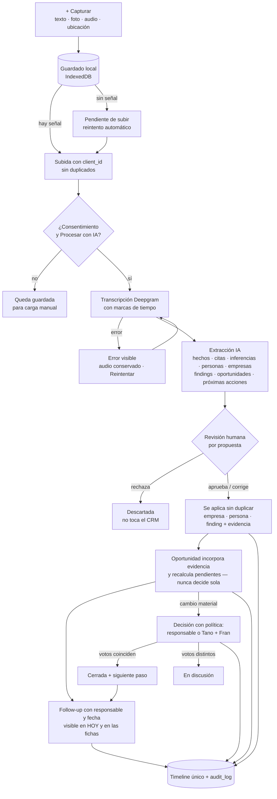

# RELEVO — V13: entregables previos a programar

**Fecha:** 29/09/2026 · **Base:** V13 (ajuste post CRM y auditoría del SaaS) sobre el plan v2 ([01-plan-flujo-rector-anelo.md](01-plan-flujo-rector-anelo.md)) · **Estado:** `para aprobar` — no se programa el nuevo alcance hasta el OK de Tano y Juan.

Responde a los 7 entregables del §13 de V13. Tres avisos antes de leer:

1. **No tengo V12.** Trabajé con el master inicial, el feedback de Tano y V13. Si V12 agrega requisitos que V13 no repite, necesito el archivo para completar la trazabilidad.
2. **No tengo acceso al CRM de Sheets.** Busqué en el Drive conectado y no aparece (probablemente está en el Drive de Tano). El mapeo (§5) está hecho sobre lo que V13 describe y se ajusta cuando vea los encabezados reales.
3. **La reestimación sube a ≈ 190 h** contra ≈ 128 h de capacidad. No lo resuelvo recortando en silencio: en §2 hay una propuesta concreta para decidir.

---

## 1. Trazabilidad V13 → pantalla → entidad/API → reutilizado/nuevo → horas → prueba

Leyenda: **R** reutiliza tal cual · **E** extiende lo existente · **M** reubica/renombra · **N** nuevo. Pruebas: C1–C7 = casos de aceptación de V13 §12; "E2E" = Playwright; "DB" = test de datos/RLS en vitest.

### Tramo A — hasta el kickoff (5/10)

| # | Requisito (V13 §) | Pantalla | Entidad / API | Tipo | h | Prueba |
|---|---|---|---|---|---|---|
| 1 | Navegación HOY · MISIÓN · MAPA · PIPELINE · DIRECTORIO + CAPTURAR; AI contextual con acceso secundario (§3, §8.6) | layout, `nav.tsx` | — | M | 4 | E2E: los 5 destinos y Capturar visibles en 375 px |
| 2 | HOY con 3 prioridades, acciones vencidas, visitas de hoy, capturas pendientes, propuestas IA, votos pendientes, cambios, Market Pulse ≤ 3; jerarquía Tano / Fran (§4.1) | `/w/[slug]` | lecturas de `tasks`, `visits`, `captures`, `ai_proposals`, `decision_votes`, `opportunities`, `news_articles` | E | 8 | C6 |
| 3 | Misión Añelo: objetivo, resultado esperado, fechas, territorio, categorías, metas y progreso, preguntas (§4.2) | `/mision/[id]` (hoy `explorar/c/[id]`) | `campaigns` + columnas; `mission_questions` (N); `verticals` → "categorías" en la UI | E | 6 | E2E: crear misión y ver progreso |
| 4 | + Capturar en línea: texto, foto, audio grabado, ubicación, vínculo opcional; guardado en 1 toque (§7.1–4) | hoja global | `captures` (N), `capture_media` (N), bucket privado `captures` | N | 10 | C1 (parte en línea) |
| 5 | Follow-ups y próxima acción en todo; "ningún negocio sin responsable y próxima acción o motivo" (§5.2) | HOY, fichas | `tasks` → follow-ups: vínculos a empresa, persona, visita, captura, misión; check en `opportunities` | E | 5 | DB: la regla se cumple en la base |
| 6 | Decisiones con votos y política por tipo; `En discusión` (§8.4) | ficha oportunidad, HOY | `decision_votes` (N); `decisions.approval_policy`, estado `en_discusion`; reemplaza `decide_opportunity()` | E | 8 | C4 + DB |
| 7 | Fichas mínimas de empresa y oportunidad con próxima acción y votos (§11A) | `e/[kind]/[id]`, `o/[oppId]` | — | R | 3 | E2E |
| 8 | Carga supervisada inicial del CRM con procedencia y sin duplicados (§9) | — (script) | `scripts/import-crm.mjs`; `sources` = hoja/pestaña/fila | N | 8 | C5 (parte) · **bloqueado por acceso al Sheet** |
| 9 | `ai_processing_consent` + interruptor "Procesar con IA" (§8.1) | Miembros/ajustes, Capturar | `workspaces.settings`, `captures.ai_consent` | E | 2 | DB: sin consentimiento no hay llamada al proveedor |
| 10 | Inventario de clicks y estados como casos de aceptación (§10) | todas | doc + E2E que recorre todos los links | N | 4 | E2E: 0 links rotos, 0 botones muertos |
| 11 | Permisos Tano/Fran; invitar a Fran con "Puede aprobar decisiones" | Miembros | `memberships` | R | 1 | manual |
| 12 | QA móvil incremental (A) | — | — | — | 2 | checklist en iPhone real |
| | **Subtotal A** | | | | **61** | |

### Tramo B — 6 al 16/10

| # | Requisito (V13 §) | Pantalla | Entidad / API | Tipo | h | Prueba |
|---|---|---|---|---|---|---|
| 13 | Mapa y lista equivalentes, filtros, cerca mío (distancia aprox.), agregar a jornada, orden manual, Google Maps, registrar llegada, ubicación no verificada con aviso (§4.3) | `/mapa` | MapLibre; `establishments.location_precision` (hoy la base **solo** admite coordenadas verificadas: se relaja); `visit_plans`/`visit_stops` | E+N | 12 | E2E + prueba en celular |
| 14 | Captura offline mínima: guardar local, "Pendiente de subir", reintento, sin duplicados, sobrevive a cerrar/bloquear (§8.5) | hoja Capturar | IndexedDB (cola) + service worker; `captures.client_id` único | N | 10 | C1 completo (modo avión) |
| 15 | Transcripción Deepgram detrás de una interfaz de proveedor; estados `guardado/subiendo/procesando/transcripto/error`, reintentos, marcas de tiempo, costo y duración (§8.1) | captura | `transcripts` (N), `ai_runs` | N | 8 | C7 (falla de transcripción) |
| 16 | Extracción IA: hechos y citas, inferencias, necesidades/objeciones/compromisos, personas y empresas, findings, oportunidades, próximas acciones (§7.7) | captura / visita | agente actual; `ai_action_drafts` → `ai_proposals` | E | 8 | DB: todo nace como borrador |
| 17 | Revisión humana por propuesta (aprobar, corregir, rechazar) y aplicación sin duplicar (§7.8–9) | bandeja de revisión | coincidencia de entidades; `findings`, `evidence` (N) | N | 10 | C2 |
| 18 | Directorio unificado: empresas, establecimientos, personas, relaciones; lista con búsqueda y filtros (§4.5) | `/directorio` (hoy `explorar/registros`) | — | M | 5 | E2E |
| 19 | Personas: relación, quién la conoce, nivel de acceso, último contacto, llamar/WhatsApp | `/directorio/p/[id]` | `contacts` + campos de relación | E | 5 | E2E |
| 20 | Visitas antes / durante / después; también llamadas y reuniones (§6 Visit/Interaction) | agenda/visita | `visits`: hoy exige objetivo de campaña → se permite empresa/persona directa + `kind` | E | 10 | C2 |
| 21 | Company Intelligence: sabemos / creemos / falta validar / quiénes / qué pasó / qué sigue / oportunidades (§5.1) | ficha empresa | `claims` (sabemos/creemos), `mission_questions` | E | 6 | C3 |
| 22 | Ficha viva de oportunidad + Pipeline en lista y Kanban (§4.4, §5.2) | `/pipeline`, `o/[oppId]` | `opportunities` + tipo, problema, propuesta; `opportunity_evidence` a favor/en contra; riesgos; economía con procedencia; solicitudes de información | E | 14 | C3 |
| 23 | Timeline único con pruebas de datos (§5) | fichas y misión | vista SQL `timeline_events` | N | 6 | DB: orden, permisos, sin duplicados |
| 24 | Briefings Tano/Fran; Fran ve "cambios desde tu última revisión" (§4.1, §11B) | HOY / briefing | `briefings`; `user_preferences.last_review_at` | E | 5 | C6 (Fran en < 2 min) |
| 25 | Importación ampliada y conciliación idempotente (§9) | Integraciones | importador CSV | E | 6 | C5 completo |
| 26 | Problemas repetidos con etiqueta manual (relación automática diferida, recorte 1) | findings | `findings.problem_tag` | E | 3 | E2E |
| 27 | Market Pulse compacto + `article_entities` / `signals` preparadas (recorte 3) | HOY | tablas nuevas | N | 3 | DB |
| 28 | QA móvil incremental (B) | — | — | — | 6 | checklist en iPhone real |
| | **Subtotal B** | | | | **117** | |

### Tramo C — 17 y 18/10

| # | Requisito | h | Prueba |
|---|---|---|---|
| 29 | Flujo rector repetido desde el celular, conectividad/reintento/duplicados, bloqueos críticos, recorrido de Fran en < 2 min, documentación de diferidos, checklist de staging | 12 | C1–C7 |

**Total: 61 + 117 + 12 = 190 h.**

## 2. Reestimación y cómo cerrar la brecha

**Capacidad** a 8 h/día hábil entre el 29/09 y el 16/10 (14 días) + fin de semana 17–18/10 de ensayo ≈ **128 h**. Brecha ≈ **62 h**. Además, el tramo A como lo define V13 (61 h) no entra en los ~36 h que quedan hasta el 5/10.

**Por qué creció desde 138 h:** captura offline (+10), CRM real (+14), revisión humana separada de la extracción (+10), QA móvil incremental (+8), ficha viva y Pipeline (+8), Directorio y navegación (+9), briefings Tano/Fran (+5), política de votos (+2). Los recortes aprobados ahorran poco porque ya estaban fuera de la estimación (tiempo de viaje, relación automática, rutas).

**Propuesta: sumar horas y partir P0 en dos entregas sin sacar nada.**

- **Horas:** trabajar los fines de semana 3–4/10 y 10–11/10 (+32 h). Brecha restante ≈ 30 h.
- **Entrega 1, Campo (18/10):** todo lo que se usa con el teléfono en Añelo. Captura, offline, transcripción, extracción y revisión, mapa, visitas, Directorio, personas, Company Intelligence, fichas mínimas de oportunidad, follow-ups, votos, HOY y carga inicial del CRM.
- **Entrega 2, Decisión (25/10, durante el viaje):** lo que se usa *después* de capturar. Kanban y ficha viva completa (economía, documentos, solicitudes: 8 h de #22), briefing ejecutivo de Fran (#24), timeline completo (3 h de #23), importación ampliada (#25) y entidades en noticias (#27). ≈ 25 h. Sigo desplegando mientras Tano está en campo.
- Las ~5 h que siguen faltando salen del pulido cosmético (recorte 5).

**Tramo A reordenado para el kickoff (≈ 42 h):** #1, #2, #3, #4, #7, #8, #9, #11. Los ítems #5 (follow-ups), #6 (votos), #10 (inventario) y #12 pasan a los primeros días de B. Si el kickoff tiene que mostrar votos sí o sí, #6 entra y la carga del CRM se hace en forma supervisada más simple.

**Si no se aprueban los fines de semana:** hay que elegir entre sumar capacidad o mover más a la Entrega 2. Mi candidato sería la extracción de *oportunidades relacionadas* dentro de #16 (queda la manual). No lo hago sin decisión explícita.

## 3. Wireframes críticos (móvil, 375 px)

### HOY — Tano

```
┌──────────────────────────────────┐
│ RELEVO · Añelo · Viaje 01    (JC)│
│ Martes 20/10 · día 2 de 7        │
├──────────────────────────────────┤
│ MIS 3 PRIORIDADES                │
│ 1 Visitar Ferretería X   10:00 ▸ │
│ 2 Llamar a R. Pérez (vence hoy) ▸│
│ 3 Revisar 4 propuestas IA       ▸│
├──────────────────────────────────┤
│ ACCIONES VENCIDAS / CERCANAS  (3)│
│ ! Pedir balance a Y     ayer   ▸ │
├──────────────────────────────────┤
│ VISITAS DE HOY                   │
│ 10:00 Ferretería X · objetivo… [Maps]
│ 15:30 Base Z · reunión con …  [Maps]
├──────────────────────────────────┤
│ CAPTURAS POR PROCESAR (2)  ⇪ 1 pendiente de subir
│ PROPUESTAS IA POR REVISAR (4)   ▸│
│ DECISIONES QUE ESPERAN TU VOTO(1)▸│
│ CAMBIOS EN OPORTUNIDADES        ▸│
├──────────────────────────────────┤
│ MARKET PULSE (3 señales)        ▸│
├──────────────────────────────────┤
│ Hoy  Misión  Mapa  Pipeline  Dir │
│                    ( + CAPTURAR )│
└──────────────────────────────────┘
```
Un bloque vacío se reemplaza por una acción concreta ("Planificar visita", "Capturar información"); nunca queda un recuadro en blanco. **Fran** ve la misma fuente con otro orden: *Desde tu última revisión* (evidencia nueva, cambios de etapa, riesgos), *Decisiones que esperan tu voto* y *Próximos hitos*.

### + CAPTURAR (hoja inferior, una mano)

```
┌──────────────────────────────────┐
│ Nueva captura                  ✕ │
│ ┌──────────────────────────────┐ │
│ │ Escribí o dictá…             │ │
│ └──────────────────────────────┘ │
│  [ ● Grabar ]  [ 📷 Foto ]        │
│  📍 Añelo · ±30 m (o "sin ubicación")
│  Vincular: [Empresa] [Persona] [Visita]  (opcional)
│  ☑ Procesar con IA (consentimiento registrado)
│ ┌──────────────────────────────┐ │
│ │          GUARDAR             │ │
│ └──────────────────────────────┘ │
└──────────────────────────────────┘
 Después de guardar: ✓ Guardado  ·  ⇪ Pendiente de subir  ·
 ⟳ Procesando  ·  ✓ Transcripto  ·  ⚠ Error — Reintentar
```
(Los íconos en la app son SVG, no emojis.)

### Company Intelligence Page

```
┌──────────────────────────────────┐
│ ‹ Directorio                     │
│ Ferretería X · proveedor · Añelo │
│ PRÓXIMA ACCIÓN: Tano · pedir lista de precios · 22/10 [Hecho]
├──────────────────────────────────┤
│ QUÉ SABEMOS  (confirmado)        │
│ • Atiende 40 contratistas/semana  [fuente: visita 20/10, min 03:12]
│ QUÉ CREEMOS  (hipótesis)         │
│ • Sin stock de X los lunes        [inferencia IA · revisada]
│ QUÉ FALTA VALIDAR                │
│ ? ¿Quién decide compras?          [Crear follow-up]
├──────────────────────────────────┤
│ QUIÉNES IMPORTAN                 │
│ R. Pérez · dueño · conoce Tano · acceso directo [Llamar][WA]
├──────────────────────────────────┤
│ OPORTUNIDADES (1) · Logística de insumos — Validación ▸
│ QUÉ PASÓ (timeline)              │
│ 20/10 Visita · audio procesado · 3 findings
│ 18/10 Captura desde la camioneta · foto + ubicación
│ 29/09 Importada del CRM (fila 12)│
│ [ Preguntar a RELEVO AI sobre esta empresa ]
└──────────────────────────────────┘
```

### Ficha viva de oportunidad

```
┌──────────────────────────────────┐
│ ‹ Pipeline                       │
│ Logística de insumos a bases     │
│ Creación propia · Etapa: Validación · Madurez: media (no es aprobación)
│ PRÓXIMA ACCIÓN: Juan · entrevistar 3 bases más · 24/10
├──────────────────────────────────┤
│ TESIS  Las bases pierden X h/semana esperando …
│ QUÉ CAMBIÓ  +2 findings a favor desde el 18/10
├──────────────────────────────────┤
│ EVIDENCIA A FAVOR (5)  EN CONTRA (1)
│ ✓ "Esperamos 2 días…" — visita Base Z, min 07:40
│ ✗ Competidor ya ofrece… — nota pública (sin verificar)
│ FALTA VALIDAR: disposición a pagar · volumen
├──────────────────────────────────┤
│ ECONOMÍA  Costo actual ARS … (declarado por contacto)
│ RIESGOS · DOCUMENTOS · SOLICITUDES
├──────────────────────────────────┤
│ DECISIÓN: ¿Pasar a piloto? · requiere Tano + Fran
│ Tano: Avanzar · "3 bases lo confirman"  ·  Fran: pendiente
│ [ Votar ]                        │
│ TIMELINE ▸   [ Preguntar a RELEVO AI ]
└──────────────────────────────────┘
```

## 4. Flujo captura → procesamiento → revisión → CRM/oportunidad → decisión → follow-up



Estados de una captura: `guardado` → `subiendo` → `procesando` → `transcripto` → `propuestas_listas` → `revisado`, más `error` (recuperable) desde cualquier paso. Sin consentimiento queda en `guardado` y no sale del workspace.

## 5. Mapeo del CRM de Sheets al modelo canónico

**Estado:** provisorio. Está armado sobre lo que V13 §9 describe; lo ajusto con los encabezados reales. **Necesito:** que compartan el Sheet con juan.martin.campos14@gmail.com, o un CSV por pestaña.

| Pestaña / concepto del CRM | Destino | Reglas |
|---|---|---|
| Empresas (53) | `companies` + `campaign_targets` de la misión Añelo | Duplicados por nombre normalizado + localidad (+ CUIT o web si existen). Tipo → `companies.kind`. |
| Categoría | `verticals` (categorías de la misión) + `target_verticals` | Se crean las que falten, sin duplicar. |
| Prioridad Alta/Media/Baja | `campaign_targets.priority` 1/2/3 | Un valor vacío pasa a 2 y se marca en el informe de importación. |
| Estado de evidencia | `verification_status` | Se mapea al catálogo: `confirmado`, `declarado_por_contacto`, `fuente_publica_sin_verificar`, `hipotesis`. Un valor dudoso pasa a `hipotesis`. |
| Contactos (18) | `contacts` + `contact_links` a la empresa | Duplicados por teléfono/email normalizado y, si no hay, nombre + empresa. La base exige fuente para guardar teléfono o email: la fuente es la fila del CRM. |
| Actividades abiertas (15) | follow-ups (`tasks`) con responsable y fecha | Responsable por nombre → usuario (Tano/Fran/Juan). Si no coincide, queda sin asignar y se marca. |
| Puntos de campo (31) | `establishments` + `campaign_targets` | Dirección → `address_text`. Las coordenadas del CRM entran como **no verificadas** (requiere relajar la base, ítem #13). |
| Próxima acción | `campaign_targets.next_action` / `next_action_due` | — |
| Enlaces y fuentes | `sources` (URL única por workspace) | — |
| Procedencia de todo lo anterior | `sources` "CRM Daicou (Sheets)", pestaña y fila + `import_batch_id` | Reimportar la misma fila no duplica (clave idempotente = hoja + pestaña + id de fila). Todo queda en el timeline: "Importada del CRM (fila N)". |

Primera carga (tramo A, #8): la ejecuta Juan con un script, primero en modo simulacro (*dry-run*) con un informe de altas, duplicados y descartes que revisan Tano o Juan antes de escribir en producción. El importador desde la UI queda en #25.

## 6. Componentes actuales: qué se conserva, renombra, reubica o sale de la navegación

| Hoy | V13 | Acción |
|---|---|---|
| Inicio (`/w/[slug]`) con noticias grandes y vistas operativo/ejecutivo | **HOY** | Se reordena. Las noticias bajan a Market Pulse (≤ 3). Las vistas pasan a ser Tano/Fran según la persona. |
| Explorar › Campañas (`explorar`, `explorar/c/[id]`) | **MISIÓN** | Se renombra. "Campaña" pasa a "Misión" en la UI; la tabla sigue siendo `campaigns`. |
| Explorar › Verticales | Categorías dentro de la misión | Sale del menú. |
| Explorar › Fuentes | Evidencia (dentro de fichas y findings) | Sale del menú. La lista completa queda en un acceso secundario. |
| Explorar › Registros + ficha `e/[kind]/[id]` | **DIRECTORIO** + Company Intelligence | Se reubica y extiende. |
| Agenda y mapa (`agenda`, planes, visita) | **MAPA** (jornadas) + visitas dentro de la misión y las fichas | Se reubica. El formulario largo de "agregar objetivo" se reemplaza por captura + completar después. |
| Oportunidades › Hallazgos, Candidatas, Dealflow, Decisiones, Briefings | **PIPELINE** (lista/Kanban) con filtros | Las pestañas pasan a ser filtros. Los objetos se conservan. |
| Ficha `o/[oppId]` | Ficha viva de oportunidad | Se extiende. |
| RELEVO AI (`/ai`) | Botón "Preguntar a RELEVO AI" en cada contexto + conversación completa como acceso secundario | Sale del menú. |
| Noticias (`/noticias`) | Market Pulse; central completa en P1 | Sale del menú y se llega desde HOY. |
| Buscar, Integraciones, Miembros, Cuenta | Menú de usuario / ajustes | Se conservan. |
| Ingesta Morning Brief (API + JSON) | Sigue alimentando findings pendientes | Se conserva. |

No se borra ninguna ruta: las URLs viejas redirigen a la nueva ubicación para no romper links ya compartidos.

## 7. Registro de recortes y backlog

| Ítem | Decisión | Dónde queda |
|---|---|---|
| Relación automática entre findings | Diferida (recorte 1); queda la etiqueta manual de problema (#26) | P1 |
| Tiempo de viaje y optimización de rutas | Diferido (recorte 2); queda la distancia aproximada | P1 |
| Central de noticias completa | Diferida (recorte 3); queda Market Pulse ≤ 3 y las tablas preparadas | P1 |
| Automatizaciones y notificaciones externas (email/WhatsApp) | Diferidas (recorte 4) | P1 (email con Resend y dominio verificado) |
| Pulido cosmético avanzado | Recortado (recorte 5), ~5 h. Se mantienen usabilidad móvil, estados de carga y error, contraste y consistencia | — |
| Kanban, ficha viva completa, briefing de Fran, timeline completo, importación desde la UI, entidades en noticias | **Movidos a la Entrega 2 (25/10)** si se aprueba §2; no se eliminan | P0 · Entrega 2 |
| Offline completo (lectura y edición sin señal) | Fuera de P0; en P0 solo la captura segura | P1 |
| Morning briefing "Good morning, Tano", cierre del día, scoring, búsqueda semántica, CSV genérico | Sin cambios respecto del plan v2 | P1 |
| Inteligencia cross-workspace, benchmarks, agentes, predicción | Sin cambios | P2 |

## 8. Decisiones que necesito para arrancar

1. **Capacidad:** ¿se aprueban los fines de semana 3–4 y 10–11/10 y P0 en dos entregas (18/10 Campo, 25/10 Decisión)? Si no, ¿qué preferís: sumar capacidad o mover más a la Entrega 2?
2. **Tramo A para el kickoff:** ¿OK con los ítems del §2, o los votos (#6) tienen que estar sí o sí el 5/10?
3. **CRM:** compartir el Sheet o exportar un CSV por pestaña.
4. **V12:** pasarme el archivo para completar la trazabilidad.
5. **Deepgram:** crear la cuenta y cargar la clave en Vercel (`DEEPGRAM_API_KEY`); no la necesito hasta el tramo B.
