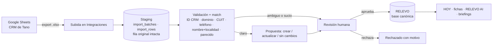

# RELEVO — Migración del CRM de Sheets (V12 + V13 + decisiones del 29/09)

**Estado:** `para aprobar` las secciones §4 y §5; el resto ya está decidido. **Snapshot perfilado:** 29/09 (67 empresas, 20 contactos, 26 actividades reales, 22 fuentes, 31 puntos de campo). Hay un delta posterior conocido (bloque 03, ACT hasta 034, CT-021/022): no es error del importador.

## 1. Flujo y fuente de verdad por etapa (V12.1, V12.5)

| Etapa | Dónde se trabaja | Regla |
|---|---|---|
| Ahora → cutover | Sheets **y** capturas/visitas en RELEVO | El Sheet se reimporta cuando cambie; RELEVO detecta nuevos, modificados y conflictos. Nada se escribe sin revisión. |
| Cutover (cuando Empresa, Persona, Activo, Fuente, Captura, Actividad, Hallazgo y Oportunidad funcionen en RELEVO) | RELEVO | El Sheet pasa a solo lectura (lo protege Tano). Queda como histórico, auditoría y export. |
| Después | RELEVO | Export CSV/JSON desde RELEVO. No hay sincronización bidireccional (V12.3 P2, no validada). |

## 2. Mapeo de pestañas

| Pestaña CRM | RELEVO | Notas |
|---|---|---|
| EMPRESAS (`AN-xxxx`) | `companies` + objetivo en la misión (`campaign_targets`) + establecimiento si hay dirección | Sector → categoría (vertical) de la misión. Prioridad Alta/Media/Baja → 1/2/3. Etapa CRM → etapa del objetivo (idioma del CRM, aprobado). |
| RED / CONTACTOS (`CT-xxx`) | `contacts` + `contact_links` a la empresa | "Persona por identificar" / buzón institucional → **canal institucional de la empresa**, no persona (va a revisión). |
| ACTIVIDADES (`ACT-xxx`) | follow-ups (`tasks`) con empresa/contacto | Solo filas con ID (hoy 26; las otras 273 son fórmulas vacías). "Tano + Fran" → dos responsables o responsable + participante (revisión). |
| FUENTES (`SRC-xxx`) | `sources` + vínculo de evidencia a la entidad | Entidad "Mercado" → fuente de contexto sin entidad (revisión). |
| EMPRESAS · "Fuente ID" (texto libre) | Fuente propuesta por coincidencia con FUENTES | Si no coincide con un `SRC-xxx`, queda como nota + revisión. |
| VISITAS / INVESTIGACIÓN · ENTREVISTAS | Capturas / visitas / preguntas de la misión | Hoy casi vacías: el campo real entra por + Capturar. |
| HALLAZGOS / OPORTUNIDADES | `findings` / `opportunities` | 0 y 0 por diseño: no se fabrican. |
| CAMPO 16–25 OCT | Agenda de la misión (bloques por día, zonas, pregunta clave) | Se importa después del piloto. |
| RADAR DE MERCADO | Noticias / señales (no evidencia de demanda) | P1. |
| INICIO · CENTRO DE CONTROL · SECTORES · DATOS · MAPA · CONFIG | Vistas y catálogos | No se importan como registros. CONFIG aporta los catálogos de etapas. |
| Activos (nuevo, bloque 03) | `assets` (ya existe) + relaciones con rol: propietario, operador, intermediario | "Publicación de un activo ≠ oportunidad" se mantiene. |

**Procedencia por registro:** `source_system = google_sheets`, `source_id` (AN-/CT-/ACT-/SRC-), `source_url`, `source_file_id`, pestaña y fila, `import_batch_id`, importador, fecha de captura, `verification_status`. La fila original completa queda guardada en staging (JSON) como respaldo de cada valor.

## 3. Datos sucios detectados (van a revisión, no se corrigen solos)

| Caso | Ejemplo real | Propuesta que verá el revisor |
|---|---|---|
| Dato en campo incorrecto | AN-0041: la web está en "Teléfono público" | Mover a Sitio oficial |
| Contacto que es un cargo | CT-001, 002, 003, 005, 006, 011–014, 019 ("persona por identificar") | Guardar como canal institucional de la empresa |
| Fuente sin entidad | SRC-004/005/006 → "Mercado" | Fuente de contexto de la misión |
| Fuente como texto libre | "AOG Patagonia 2026 / sitio oficial Mobilbox" | Vincular a SRC existente o crear fuente |
| Actividad escrita como texto | "Próxima acción" en EMPRESAS sin ACT correspondiente | Crear follow-up (opcional) |
| Posible duplicado | nombre + localidad parecido a una entidad existente | Unir, vincular o mantener separadas |

## 4. Para aprobar: estados de evidencia del CRM → catálogo canónico

| Valor en el CRM | `verification_status` | Revisión |
|---|---|---|
| Pre-mapeado · No verificado · vacío | `unverified` | no |
| Fuente pública pendiente revalidación | `partially_verified` | no |
| Verificado públicamente (con o sin detalle AOG) | `publicly_verified` | no; el detalle queda como nota |
| "Ficha comercial; validar …" (texto libre) | `partially_verified` | sí (el texto queda como pregunta abierta) |
| — (calculado) | `stale` cuando pasan más de 30 días sin verificar (umbral de CONFIG) | — |

Migración de datos existentes en RELEVO: ver docs/04-modelo-canonico.md §10.

## 5. Para aprobar: política de conflictos durante la transición

- **Propiedad por registro:** un registro importado sigue siendo "del Sheet" hasta que alguien lo edita en RELEVO. Desde ese momento es "de RELEVO".
- Si el Sheet cambia un registro que ya es de RELEVO, la reimportación **no lo pisa**: muestra el conflicto campo por campo y la persona elige.
- Si el Sheet cambia un registro que sigue siendo del Sheet, se propone la actualización (se aplica al aprobar el lote).
- Nunca se borra nada en RELEVO porque desapareció del Sheet: se marca "ya no está en el Sheet" para revisión.

## 6. Contradicciones con V12 revisadas

| V12 / V11 | Decisión posterior | Estado |
|---|---|---|
| V11.3: cinco destinos Inicio · Explorar · Agenda y mapa · Oportunidades · RELEVO AI | V13 §8.6: Hoy · Misión · Mapa · Pipeline · Directorio + Capturar; AI contextual | Resuelta por V13 |
| V11.9 / V12: offline en P2 | V13 §8.5: captura offline mínima en P0 | Resuelta por V13 (implementada) |
| V12.3: sincronización incremental solo en P2 | 29/09 §8: seguir cargando el Sheet; RELEVO detecta nuevos/modificados | Compatible: **reimportación manual idempotente con diff** (P0), no sincronización automática. Ver §5 |
| V12.2: procedencia "de cada campo" | — | Propuesta: procedencia por registro + fila original guardada; por campo solo en conflictos |
| V12.3 P1: lectura de Google por OAuth | Hoy el Sheet está compartido "cualquiera con el enlace" | **Riesgo de privacidad** (teléfonos y correos de contactos). Recomendación: restringir el enlace; importar subiendo el .xlsx exportado. OAuth queda P1 |
| Master: verificación `confirmado / declarado_por_contacto / …` | 29/09 §1: catálogo `unverified … stale` | Resuelta: reemplazo aprobado |
| V11.5 / estados de objetivo propios | 29/09 §2: etapas del CRM | Resuelta: se adoptan las del CRM |

## 7. Piloto (aprobado)

AN-0023 Hotel Leonardo Da Vinci (+ CT-005, ACT-003 y su fuente) · AN-0054 Mobilbox (AOG) · AN-0029 YPF (comprador corporativo). Criterio: `Sheets → RELEVO → relaciones → procedencia → dedupe/revisión → visualización → modificación → reimportación` sin duplicados ni pérdida de contexto. Casos V12.4 que se prueban además: importar dos veces el mismo archivo, archivo malformado rechazado sin corrupción y export del estado.

## 8. Estado (30/09): implementado

- **Integraciones → CRM de Google Sheets:** subir el `.xlsx` (opcional: solo algunas empresas) → lote en revisión → aprobar/rechazar por fila (propuestas y conflictos se deciden explícitamente) → "Escribir N aprobadas en RELEVO".
- Crea empresa + objetivo en la misión (etapa, prioridad, responsable, próxima acción) + categoría + establecimiento si hay dirección; persona o canal institucional vinculado; follow-up vinculado a objetivo y persona; fuente + evidencia ("Hecho que sustenta") sobre la empresa.
- Procedencia en `external_refs` (ID del CRM, pestaña, fila, lote) y fila original guardada en staging. La ficha muestra "De dónde salió".
- Reimportar: sin cambios no toca nada; cambios solo del Sheet se proponen; cambio en ambos lados = conflicto por campo; lo editado en RELEVO no se pisa. Archivo malformado se rechaza entero.
- Pruebas: `tests/db/crm-import.test.ts` (ciclo completo con RLS), `src/domain/crm-import/*.test.ts` (mapeo, diff, duplicados), `e2e/importar-crm.spec.ts` (interfaz). El piloto AN-0023 / AN-0054 / AN-0029 se corrió con el export real en local.

**Hallazgo en el Sheet:** en EMPRESAS y RED | CONTACTOS el `ID` es una fórmula `="AN-"&TEXT(ROW()-4,…)`: depende de la posición de la fila. Insertar o borrar filas corre los IDs (así se pisó AN-0065). EMPRESAS tiene "ID anterior" como valor fijo y el importador usa ese; CONTACTOS no, así que sus IDs son inestables. Recomendación: pegar los IDs como valores en ambas pestañas.

## 9. Aceptación del incremento B en producción (29/09, 15:34–15:48)

Piloto controlado con el export actual del Sheet, limitado a AN-0023, AN-0054 y AN-0029, ejecutado desde la interfaz de producción con la cuenta de Juan.

| Paso | Resultado |
|---|---|
| Staging | 11 filas nuevas (3 empresas, 4 contactos —CT-005 y CT-011 son canales institucionales, CT-023/024 del delta—, 1 fuente, 3 actividades). Nada escrito antes de aprobar. |
| SRC-NEW-LDV | Reconocida como fuente de AN-0023 y de CT-005; existe **una sola vez** en RELEVO. |
| Aprobación y escritura | 11 filas escritas; tres fichas con empresa, personas/canales, actividades, evidencia, próxima acción, procedencia (pestaña y fila) e historial. |
| Reimportar el mismo archivo | 11 "sin cambios", 0 duplicados. |
| Conflicto controlado (Notas de YPF) | Editado en RELEVO y distinto en el archivo → "Conflicto" con base, RELEVO y Sheet; no deja aprobar sin elegir; se eligió el Sheet y quedó registrado en el lote y en el historial. |
| Vuelta al Sheet real | Propuso "Notas → vacío" como cambio solo del Sheet; aprobado; YPF volvió al estado original. |
| Integridad final | 3 empresas · 3 objetivos · 2 establecimientos · 4 contactos · 3 actividades · 3 fuentes · 2 evidencias · 11 referencias de procedencia · 4 lotes aplicados. |

**Anomalías encontradas y corregidas durante el piloto:** (1) el detalle del estado de verificación ("expositor AOG 2026 + operación Neuquén") se perdía y la fuente citada en texto libre no se registraba → ahora son evidencia y fuente "citada por el CRM", completadas por la reimportación sin duplicar; (2) fechas del CRM mostradas un día antes (UTC) → mediodía de Argentina; dos evidencias del piloto corregidas; (3) falsos "editado en RELEVO" (nota de responsables compartidos, fecha de carga por defecto); (4) un .xlsx re-guardado fuera de Google Sheets (rutas internas absolutas) se rechazaba → se normaliza antes de leer; (5) el aviso de IDs por fórmula contaba filas vacías de plantilla; (6) la ficha no enlazaba al lote y su decisión → "Ver el lote y sus decisiones".

**Pendiente del lado del Sheet:** sigue compartido con "cualquiera con el enlace".

## 10. Revisión por excepción (P2, 30/09)

Control humano ≠ un clic por fila. Cada lote se clasifica con una sola función (`src/domain/crm-import/triage.ts`), que arma el resumen y decide qué aprueba "Aprobar lote":

- **Sin conflicto** (entra con el lote): registro nuevo que no coincide con nada de RELEVO ni con otra fila del archivo, o cambio del Sheet en campos que RELEVO no modificó y que no identifican al registro. Solo puede traer avisos informativos, que se resumen con su conteo.
- **Requiere revisión** (una por una): cambió en RELEVO y en el Sheet; posible duplicado (contra RELEVO o dentro del mismo archivo); cambio en un dato que identifica (nombre, teléfono, email, sitio web, empresa vinculada); dato dudoso con o sin propuesta (cargo en lugar de persona, estado en texto libre, etapa o prioridad desconocida).
- **Bloqueada** (no entra): referencia a un registro inexistente, sin nombre, sin ID o ID que cambió de fila. Se corrige en el Sheet y se vuelve a importar.

Se mantienen staging, procedencia, diff de tres vías y nada se escribe sin aprobación. En el lote real del 29/09 (271 filas): 235 sin conflicto, 24 a revisar (entre ellas "Vaca Muerta Facility Group" repetida en dos filas), 4 bloqueadas, 7 sin cambios.
